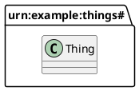
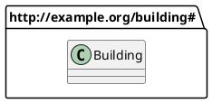
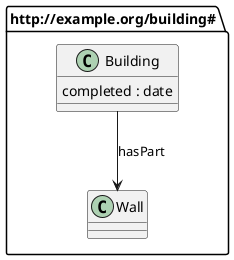
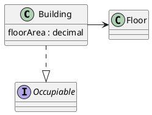
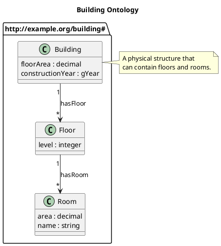

# PlantUML Import Guide

Convert PlantUML class diagrams to RDF/OWL ontologies with the `from-uml` command.

## Quick Start

```bash
# Basic conversion
rdf-construct from-uml design.puml

# Specify output and namespace
rdf-construct from-uml design.puml -o ontology.ttl -n http://example.org/building#

# Validate without generating
rdf-construct from-uml design.puml --validate
```

## Supported PlantUML Syntax

### Classes

```plantuml
' Simple class
class Building

' Class with attributes
class Building {
    floorArea : decimal
    constructionYear : gYear
    name : string
}

' Abstract class
abstract class Entity

' Class with stereotype
class Building <<persistent>>
```

### Relationships

```plantuml
' Inheritance (generates rdfs:subClassOf)
Building --|> Entity
Entity <|-- Building  ' Same meaning, reversed arrow

' Association (generates owl:ObjectProperty)
Building --> Floor : hasFloor

' With cardinalities (preserved as comments)
Building "1" --> "*" Floor : hasFloor

' Aggregation and composition
Building o-- Room : contains
Building *-- Foundation : hasFoundation
```

### Packages and Namespaces

```plantuml
' Package with explicit namespace URI
package "http://example.org/building#" as bld {
    class Building
    class Floor
}

' Simple package (generates namespace from name)
package core {
    class Entity
}
```

**There is one spelling.** In `package "<namespace IRI>" as <prefix>` the quoted string is the
namespace IRI and the alias after `as` is the prefix, so `bld:Building` is
`<http://example.org/building#Building>`. An IRI is anything that starts with a scheme, so
`urn:example:building#` works as well as `http:`. An IRI that ends in none of `#`, `/` or `:`
has `#` appended, so `urn:example:building:` is used as it stands. A quoted name that is not an IRI is display text: `package "Building Things" as bld`
is `package bld`.

**A package with an IRI and no alias** gets a prefix derived from the IRI's last segment, and the
run says which one. Given `things.puml`:



```bash
rdf-construct puml2rdf things.puml -o things.ttl
```

```text
Parsing things.puml...
Parse notes:
  Line 2: derived the prefix "things" for <urn:example:things#>; to choose it, write package "urn:example:things#" as <prefix>
  Found: 1 classes, 0 relationships
Converting to RDF...
  Generated: 3 triples
✓ Wrote things.ttl
  Classes: 1, Properties: 0
```

The derived prefix is a **note**, not a warning: nothing is missing from the output, so `--strict`
lets it through.

**A prefix the diagram names is used as written, or the run is refused.** That covers an alias,
a simple package's name, and the part before the dot in `class bld.Building`. A refused run
exits 2, names the line, and writes nothing:

| The diagram has | Refused because |
|---|---|
| `package bld as "http://example.org/building#"` | it is the reverse spelling; the message shows the form above |
| `as 2nd`, `as pkg.`, `as :` | it is not a legal Turtle prefix: one starts with a letter, holds only letters, digits, `_`, `-` and `.`, and does not end with `.` |
| `as owl` on any namespace but OWL's, or `class rdfs.Thing` | `rdf`, `rdfs`, `owl`, `xsd` and `xml` are bound to their own namespaces |
| two packages `as ex` with different IRIs | one prefix cannot name two namespaces |
| one IRI as both `as ex` and `as ey` | one namespace cannot have two prefixes |
| two IRIs with no alias whose derived prefixes are the same | the derived prefix is already taken; name one with `as` |

Given `reversed.puml`:



```bash
rdf-construct puml2rdf reversed.puml -o reversed.ttl
```

```text
Parsing reversed.puml...
Parse errors:
  Line 2: the namespace IRI goes in quotes before "as", and the prefix after it: package "http://example.org/building#" as bld
```

### Notes and Comments

```plantuml
' Single-line note
note right of Building : A physical structure

' Multi-line note
note right of Building
    A physical structure
    that can be occupied.
end note
```

Notes attached to classes become `rdfs:comment` in the generated ontology.

## RDF Mapping

### Classes

| PlantUML | RDF |
|----------|-----|
| `class Building` | `bld:Building rdf:type owl:Class` |
| `abstract class Entity` | `bld:Entity rdf:type owl:Class` |
| Note attached to class | `rdfs:comment` |

### Attributes

Attributes become `owl:DatatypeProperty` with domain set to the containing class:

| PlantUML | RDF |
|----------|-----|
| `floorArea : decimal` | `bld:floorArea rdf:type owl:DatatypeProperty ; rdfs:domain bld:Building ; rdfs:range xsd:decimal` |

### Supported Datatypes

| PlantUML Type | XSD Type |
|---------------|----------|
| `string`, `str`, `text` | `xsd:string` |
| `integer`, `int` | `xsd:integer` |
| `decimal`, `float`, `double` | `xsd:decimal`, `xsd:float`, `xsd:double` |
| `boolean`, `bool` | `xsd:boolean` |
| `date`, `datetime`, `time` | `xsd:date`, `xsd:dateTime`, `xsd:time` |
| `gYear`, `gYearMonth` | `xsd:gYear`, `xsd:gYearMonth` |
| `uri`, `anyURI`, `url` | `xsd:anyURI` |

### Relationships

| PlantUML | RDF |
|----------|-----|
| `A --\|> B` | `A rdfs:subClassOf B` |
| `A --> B : label` | `label rdf:type owl:ObjectProperty ; rdfs:domain A ; rdfs:range B` |

## CLI Reference

```bash
rdf-construct from-uml [OPTIONS] SOURCE
```

### Arguments

| Argument | Description |
|----------|-------------|
| `SOURCE` | PlantUML file (.puml or .plantuml) |

### Options

| Option | Description |
|--------|-------------|
| `-o, --output PATH` | Output file path (default: source with .ttl extension). Refused (exit 2) if it names the diagram or the `-C` config; it may name the `--merge` ontology |
| `-f, --format FORMAT` | Output format: turtle, xml, jsonld, nt (default: turtle) |
| `-n, --namespace URI` | Default namespace URI for the ontology |
| `-C, --config PATH` | Path to YAML configuration file |
| `-m, --merge PATH` | Existing ontology file to merge with |
| `-v, --validate` | Check the diagram and the RDF it converts to, without writing output |
| `--strict` | Treat warnings as errors: exit 1 and write nothing |
| `-l, --language TAG` | Language tag for labels/comments (default: en) |
| `--no-labels` | Don't auto-generate rdfs:label triples |

### Exit Codes

| Code | Meaning |
|------|---------|
| 0 | Success, including a run with warnings when `--strict` is not given |
| 1 | Warnings, with `--strict`; nothing is written. Or `--merge` replaced or kept back a value the ontology held: written, unless `--strict` is given |
| 2 | Refused or failed: no `@startuml` or `@enduml`, a parse error, a model error, a `--merge` ontology that cannot be parsed, or RDF that cannot be written |

## Configuration File

Create a YAML configuration file for advanced control:

```yaml
# puml-import.yml

# Default namespace for entities without explicit package
default_namespace: "http://example.org/building#"

# Language tag for labels and comments
language: "en"

# Automatically generate rdfs:label from entity names
generate_labels: true

# Convert camelCase names to readable labels
# e.g., 'floorArea' -> 'floor area'
camel_to_label: true

# Map PlantUML packages to RDF namespaces
namespace_mappings:
  - package: "building"
    namespace_uri: "http://example.org/building#"
    prefix: "bld"
  - package: "core"
    namespace_uri: "http://example.org/core#"
    prefix: "core"

# Custom datatype mappings
datatype_mappings:
  Money: "xsd:decimal"
  Percentage: "xsd:decimal"

# Preferred prefix ordering in output
prefix_order:
  - ""
  - "owl"
  - "rdfs"
  - "xsd"

# URIs to include as owl:imports
ontology_imports:
  - "http://example.org/core"
```

Use with:

```bash
rdf-construct from-uml design.puml -C puml-import.yml
```

## Merging with Existing Ontologies

`--merge` adds what a diagram says to an ontology you also edit by hand. Name the same file
with `-o` and the ontology is updated in place:

```bash
rdf-construct puml2rdf design.puml --merge ontology.ttl -o ontology.ttl
```

A diagram can say only part of what an ontology says. It can declare a class, an object
property or a datatype property, give a class named superclasses, and give a property a domain
and a range. A merge keeps everything else the ontology says about the same terms.

Take this diagram, `design.puml`:



And this ontology, `ontology.ttl`, with a restriction, two OWL characteristics and a comment
the diagram cannot draw:

```turtle
@prefix bld: <http://example.org/building#> .
@prefix owl: <http://www.w3.org/2002/07/owl#> .
@prefix rdfs: <http://www.w3.org/2000/01/rdf-schema#> .
@prefix xsd: <http://www.w3.org/2001/XMLSchema#> .

<http://example.org/building> a owl:Ontology .

bld:Building a owl:Class ;
    rdfs:comment "A structure with a roof and walls."@en ;
    rdfs:subClassOf [ a owl:Restriction ;
            owl:onProperty bld:hasPart ;
            owl:someValuesFrom bld:Wall ] .

bld:hasPart a owl:ObjectProperty, owl:TransitiveProperty .

bld:completed a owl:DatatypeProperty, owl:FunctionalProperty ;
    rdfs:range xsd:dateTime .
```

The merge prints:

```text
Parsing design.puml...
  Found: 2 classes, 1 relationships
Converting to RDF...
  Generated: 13 triples
Merging with ontology.ttl...
  Added: 9, Preserved: 11, Replaced: 1
Merge conflicts:
  ⚠ bld:completed rdfs:range xsd:dateTime was replaced by the diagram's xsd:date.
✓ Wrote ontology.ttl
  Classes: 2, Properties: 2
```

It exits 1, because it replaced a value the ontology held. `ontology.ttl` now holds:

```turtle
@prefix bld: <http://example.org/building#> .
@prefix owl: <http://www.w3.org/2002/07/owl#> .
@prefix rdfs: <http://www.w3.org/2000/01/rdf-schema#> .
@prefix xsd: <http://www.w3.org/2001/XMLSchema#> .

<http://example.org/building> a owl:Ontology .

bld:completed a owl:DatatypeProperty,
        owl:FunctionalProperty ;
    rdfs:label "completed"@en ;
    rdfs:domain bld:Building ;
    rdfs:range xsd:date .

bld:hasPart a owl:ObjectProperty,
        owl:TransitiveProperty ;
    rdfs:label "hasPart"@en ;
    rdfs:domain bld:Building ;
    rdfs:range bld:Wall .

bld:Building a owl:Class ;
    rdfs:label "building"@en ;
    rdfs:comment "A structure with a roof and walls."@en ;
    rdfs:subClassOf [ a owl:Restriction ;
            owl:onProperty bld:hasPart ;
            owl:someValuesFrom bld:Wall ] .

bld:Wall a owl:Class ;
    rdfs:label "wall"@en .
```

### Merge Behaviour

- **Types are added, never removed.** OWL characteristics, `owl:NamedIndividual`, `rdfs:Class`
  and `owl:DeprecatedClass` all stay.
- **The ontology wins a clash of kinds.** If the diagram makes a term a class or an object
  property and the ontology says it is a different kind of term, such as a datatype or
  annotation property, the ontology's type is kept, the diagram's is not written, and the clash
  is reported.
- **A superclass, domain or range is replaced only by the diagram's own.** The ontology's value
  is replaced only if the diagram gives the same term a value for it and also draws the class it
  names. For a datatype property's range, any named datatype counts. A superclass the diagram
  does not draw, such as one from an imported ontology, stays. A restriction, a union or any
  other blank-node value is never replaced.
- **Every replacement and every clash is reported** on stderr, one line each, and the run exits
  1. With `--strict` it exits 1 before writing anything.
- **Terms the diagram does not mention stay as they are**, including ones you deleted from the
  diagram. Labels, comments and every other annotation are kept.
- **The ontology keeps its own header.** If it has an `owl:Ontology`, the one the diagram would
  make is not added.
- **The ontology is read in its own format**, from its extension: `.ttl`, `.rdf`, `.owl`,
  `.xml`, `.jsonld`, `.json`, `.nt` or `.n3`. Any other extension is read as Turtle. One that
  cannot be read is refused at exit 2, with nothing written.

### Known Limitations

| What happens | Issue |
|---|---|
| The output is written in `-f`'s format (Turtle by default), whatever `-o`'s extension. Pass `-f xml` to merge into a `.rdf` file in place, or the next run cannot read it. | [#162](https://github.com/aigora-de/rdf-construct/issues/162) |
| A diagram that `uml` drew has no packages, so its terms are minted in another namespace and match nothing in the ontology the diagram came from. Each merge adds a second copy. | to be filed |
| `uml`'s property and individual boxes are read as classes, so merging its diagram back reports a clash for every property. | [#395](https://github.com/aigora-de/rdf-construct/issues/395) |
| A merge can create an `rdfs:subClassOf` cycle without saying so. | — |

## Validation

`--validate` runs everything a conversion does except the merge and the write: it parses the
diagram, checks the model, converts it, checks the RDF, and serialises it in memory in the
requested format. Nothing is written.

```bash
rdf-construct from-uml design.puml --validate
```

### Checks Performed

**Parsing:**
- The file must hold a whole diagram, from `@startuml` to `@enduml`. Without either marker the run
  is refused: exit 2, nothing written. A fragment must be wrapped in `@startuml` … `@enduml`.
  Only the first diagram is read: text before `@startuml`, or after the `@enduml` that closes it,
  is reported and not converted. A leading byte-order mark is ignored.
- Every line the parser does not read is reported by its line number, unless it is a comment,
  layout or presentation: `'` and `/' … '/` comments, closing braces, `hide`/`show`,
  `left to right direction`, `top to bottom direction`, `!include`, `!theme`, `skinparam`,
  `legend`, `header`, `footer`, `caption`, `title` and `together`. A block of these that is never
  closed is reported on its opening line.
- Declarations of kinds the converter does not model are named as dropped: `interface`, `enum`,
  `annotation`, `entity`, `struct`, `abstract Foo` without `class`, realisation (`..|>`) and
  dependency (`..>`). So are `extends` and `implements` on a class line: the class is converted,
  its superclass is not; write `Car --|> Base` instead.
- A diagram with no classes or relationships is converted with a warning.

Given `design.puml`:



```bash
rdf-construct puml2rdf design.puml --validate --strict
```

```text
Parsing design.puml...
Parse warnings:
  Line 5: interface Occupiable is not converted: only classes are, so Occupiable is not in the output
  Line 6: realisation is not converted, so it is not in the output: Building ..|> Occupiable
  ⚠ 1 line not understood (7) — it is not in the output.
  Found: 1 classes, 0 relationships
Aborting due to --strict mode
```

Without `--strict`, the same diagram converts at exit 0 and the three lines are not in the output.

**Model Validation:**
- Duplicate class names
- Relationships reference existing classes
- Inheritance cycles
- Unknown datatypes

**RDF Validation:**
- Classes properly typed
- Properties have domain/range
- No dangling references
- The RDF can be written in the requested format

### Strict Mode

Treat warnings as errors for CI pipelines. Under `--strict` any parse, model, conversion or RDF
warning stops the run at exit 1 with nothing written; a derived prefix is a note and does not:

```bash
rdf-construct from-uml design.puml --validate --strict
```

## Examples

### Basic Building Ontology

**Input** (`building.puml`):



**Command:**

```bash
rdf-construct from-uml building.puml -o building.ttl
```

**Output** (`building.ttl`):

```turtle
@prefix bld: <http://example.org/building#> .
@prefix owl: <http://www.w3.org/2002/07/owl#> .
@prefix rdfs: <http://www.w3.org/2000/01/rdf-schema#> .
@prefix xsd: <http://www.w3.org/2001/XMLSchema#> .

<http://example.org/building> a owl:Ontology ;
    rdfs:label "Building Ontology"@en .

bld:Building a owl:Class ;
    rdfs:label "building"@en ;
    rdfs:comment "A physical structure that can contain floors and rooms."@en .

bld:Floor a owl:Class ;
    rdfs:label "floor"@en .

bld:Room a owl:Class ;
    rdfs:label "room"@en .

bld:floorArea a owl:DatatypeProperty ;
    rdfs:domain bld:Building ;
    rdfs:range xsd:decimal ;
    rdfs:label "floor area"@en .

bld:constructionYear a owl:DatatypeProperty ;
    rdfs:domain bld:Building ;
    rdfs:range xsd:gYear ;
    rdfs:label "construction year"@en .

bld:level a owl:DatatypeProperty ;
    rdfs:domain bld:Floor ;
    rdfs:range xsd:integer ;
    rdfs:label "level"@en .

bld:area a owl:DatatypeProperty ;
    rdfs:domain bld:Room ;
    rdfs:range xsd:decimal ;
    rdfs:label "area"@en .

bld:name a owl:DatatypeProperty ;
    rdfs:domain bld:Room ;
    rdfs:range xsd:string ;
    rdfs:label "name"@en .

bld:hasFloor a owl:ObjectProperty ;
    rdfs:domain bld:Building ;
    rdfs:range bld:Floor ;
    rdfs:label "has floor"@en .

bld:hasRoom a owl:ObjectProperty ;
    rdfs:domain bld:Floor ;
    rdfs:range bld:Room ;
    rdfs:label "has room"@en .
```

## Unsupported Syntax

The following PlantUML features are not currently supported:

- Interface declarations (`interface`), reported as not converted
- Enum declarations (`enum`), reported as not converted
- Method declarations in classes
- Composition/aggregation semantic distinction (treated as associations)
- Generic types (`List<String>`)
- Constraint expressions in attributes
- Sequence diagrams, activity diagrams, etc.

## Tips

### Label Generation

By default, camelCase names are converted to readable labels:
- `floorArea` → "floor area"
- `hasBuilding` → "has building"

Disable with `--no-labels` or configure in YAML.

### Round-Trip Workflow

For ongoing development:

1. Start with PlantUML diagram
2. Generate initial RDF: `rdf-construct puml2rdf design.puml -o ontology.ttl`
3. Add detailed annotations, characteristics and restrictions by hand
4. Update PlantUML and merge: `rdf-construct puml2rdf design.puml --merge ontology.ttl -o ontology.ttl`.
   The merge keeps what you added and reports anything the diagram replaced (see
   [Merging with Existing Ontologies](#merging-with-existing-ontologies)).

### CI Integration

Add to your CI pipeline:

```yaml
# .github/workflows/ontology.yml
- name: Validate PlantUML
  run: rdf-construct from-uml design.puml --validate --strict

- name: Generate ontology
  run: rdf-construct from-uml design.puml -o ontology.ttl
```
