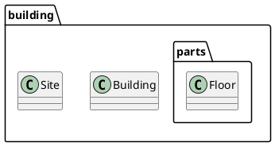
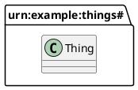
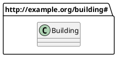
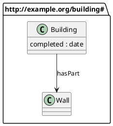
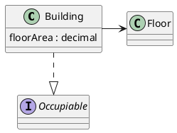
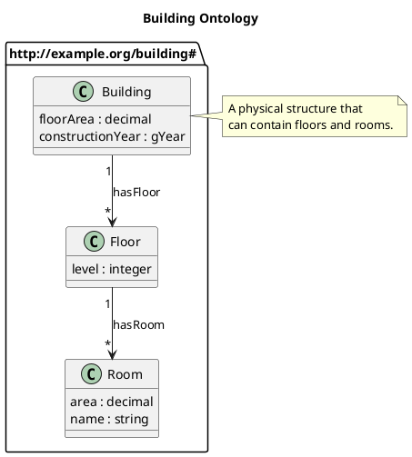

# PlantUML Import Guide

Convert PlantUML class diagrams to RDF/OWL ontologies with the `from-uml` command.

## Quick Start

```bash
# Basic conversion
rdf-construct from-uml design.puml

# Specify output and namespace
rdf-construct from-uml design.puml -o ontology.ttl -n http://example.org/building#

# Validate without generating
rdf-construct from-uml design.puml --validate
```

## Supported PlantUML Syntax

### Classes

```plantuml
' Simple class
class Building

' Class with attributes
class Building {
    floorArea : decimal
    constructionYear : gYear
    name : string
}

' Abstract class
abstract class Entity

' Class with stereotype
class Building <<persistent>>
```

### Relationships

```plantuml
' Inheritance (generates rdfs:subClassOf)
Building --|> Entity
Entity <|-- Building  ' Same meaning, reversed arrow

' Association (generates owl:ObjectProperty)
Building --> Floor : hasFloor

' With cardinalities (preserved as comments)
Building "1" --> "*" Floor : hasFloor

' Aggregation and composition
Building o-- Room : contains
Building *-- Foundation : hasFoundation
```

### Packages and Namespaces

```plantuml
' Package with explicit namespace URI
package "http://example.org/building#" as bld {
    class Building
    class Floor
}

' Simple package (generates namespace from name)
package core {
    class Entity
}
```

**There is one spelling.** In `package "<namespace IRI>" as <prefix>` the quoted string is the
namespace IRI and the alias after `as` is the prefix, so `bld:Building` is
`<http://example.org/building#Building>`. An IRI is anything that starts with a scheme, so
`urn:example:building#` works as well as `http:`. An IRI that ends in none of `#`, `/` or `:`
has `#` appended, so `urn:example:building:` is used as it stands. A quoted name that is not an IRI is display text: `package "Building Things" as bld`
is `package bld`.

**A package nested in another** holds the classes declared inside it; a class after the inner
block belongs to the outer one again. A nested package without an IRI is named by its path, as
PlantUML names it: `parts` inside `building` is `building.parts`, the same package
`class building.parts.Floor` names, so the two spellings mint the same IRI. A nested package with
an IRI of its own uses that IRI and its own prefix. Given `nested.puml`:



```bash
rdf-construct puml2rdf nested.puml -o nested.ttl
```

`nested.ttl` holds:

```turtle
@prefix building: <http://example.org/ontology/building#> .
@prefix building.parts: <http://example.org/ontology/building.parts#> .
@prefix owl: <http://www.w3.org/2002/07/owl#> .
@prefix rdfs: <http://www.w3.org/2000/01/rdf-schema#> .

<http://example.org/ontology> a owl:Ontology .

building:Building a owl:Class ;
    rdfs:label "building"@en .

building:Site a owl:Class ;
    rdfs:label "site"@en .

building.parts:Floor a owl:Class ;
    rdfs:label "floor"@en .
```

**A package with an IRI and no alias** gets a prefix derived from the IRI's last segment, and the
run says which one. Given `things.puml`:



```bash
rdf-construct puml2rdf things.puml -o things.ttl
```

```text
Parsing things.puml...
Parse notes:
  Line 2: derived the prefix "things" for <urn:example:things#>; to choose it, write package "urn:example:things#" as <prefix>
  Found: 1 classes, 0 relationships
Converting to RDF...
  Generated: 3 triples
✓ Wrote things.ttl
  Classes: 1, Properties: 0
```

The derived prefix is a **note**, not a warning: nothing is missing from the output, so `--strict`
lets it through.

**A prefix the diagram names is used as written, or the run is refused.** That covers an alias,
a simple package's name, and the part before the dot in `class bld.Building`. A refused run
exits 2, names the line, and writes nothing:

| The diagram has | Refused because |
|---|---|
| `package bld as "http://example.org/building#"` | it is the reverse spelling; the message shows the form above |
| `as 2nd`, `as pkg.`, `as :` | it is not a legal Turtle prefix: one starts with a letter, holds only letters, digits, `_`, `-` and `.`, and does not end with `.` |
| `as owl` on any namespace but OWL's, or `class rdfs.Thing` | `rdf`, `rdfs`, `owl`, `xsd` and `xml` are bound to their own namespaces |
| two packages `as ex` with different IRIs | one prefix cannot name two namespaces |
| one IRI as both `as ex` and `as ey` | one namespace cannot have two prefixes |
| two IRIs with no alias whose derived prefixes are the same | the derived prefix is already taken; name one with `as` |

Given `reversed.puml`:



```bash
rdf-construct puml2rdf reversed.puml -o reversed.ttl
```

```text
Parsing reversed.puml...
Parse errors:
  Line 2: the namespace IRI goes in quotes before "as", and the prefix after it: package "http://example.org/building#" as bld
```

### Notes and Comments

```plantuml
' Single-line note
note right of Building : A physical structure

' Multi-line note
note right of Building
    A physical structure
    that can be occupied.
end note
```

Notes attached to classes become `rdfs:comment` in the generated ontology.

## RDF Mapping

### Classes

| PlantUML | RDF |
|----------|-----|
| `class Building` | `bld:Building rdf:type owl:Class` |
| `abstract class Entity` | `bld:Entity rdf:type owl:Class` |
| Note attached to class | `rdfs:comment` |

### Attributes

Attributes become `owl:DatatypeProperty` with domain set to the containing class:

| PlantUML | RDF |
|----------|-----|
| `floorArea : decimal` | `bld:floorArea rdf:type owl:DatatypeProperty ; rdfs:domain bld:Building ; rdfs:range xsd:decimal` |

### Supported Datatypes

A type name matches without regard to case: `String`, `string` and `STRING` are all
`xsd:string`.

| PlantUML Type | XSD Type |
|---------------|----------|
| `string`, `str`, `text` | `xsd:string` |
| `integer`, `int` | `xsd:integer` |
| `decimal`, `number` | `xsd:decimal` |
| `float` | `xsd:float` |
| `double` | `xsd:double` |
| `boolean`, `bool` | `xsd:boolean` |
| `date` | `xsd:date` |
| `datetime` | `xsd:dateTime` |
| `time` | `xsd:time` |
| `gYear` | `xsd:gYear` |
| `gYearMonth` | `xsd:gYearMonth` |
| `duration` | `xsd:duration` |
| `uri`, `anyURI`, `url` | `xsd:anyURI` |
| `base64` | `xsd:base64Binary` |
| `hexBinary` | `xsd:hexBinary` |
| `language` | `xsd:language` |
| `token` | `xsd:token` |

`xsd:date`, `xsd:time`, `xsd:gYear`, `xsd:gYearMonth` and `xsd:duration` are XSD datatypes but
are not in the OWL 2 datatype map, so an OWL 2 DL reasoner may not accept them as ranges.

Any other datatype can be written as a CURIE: `q : xsd:gYearMonth`, `l : rdf:langString`. A
CURIE in `xsd:`, `rdf:`, `rdfs:` or `owl:` must name one of their datatypes, with its own
case: `xsd:Foo` and `xsd:gyearmonth` are refused at exit 2 (`NOT_A_DATATYPE`).

A type the map does not know, such as `Money`, is written as `xsd:string` and warned once:

```text
Unknown datatype 'Money' for attribute 'Building.value'; written as xsd:string. Map it under datatype_mappings in a -C config
```

Map it under `datatype_mappings` in a [configuration file](#configuration-file) to give it a
datatype of its own.

### Relationships

| PlantUML | RDF |
|----------|-----|
| `A --\|> B` | `A rdfs:subClassOf B` |
| `A --> B : label` | `label rdf:type owl:ObjectProperty ; rdfs:domain A ; rdfs:range B` |

## CLI Reference

```bash
rdf-construct from-uml [OPTIONS] SOURCE
```

### Arguments

| Argument | Description |
|----------|-------------|
| `SOURCE` | PlantUML file (.puml or .plantuml) |

### Options

| Option | Description |
|--------|-------------|
| `-o, --output PATH` | Output file path (default: source with .ttl extension). Refused (exit 2) if it names the diagram or the `-C` config; it may name the `--merge` ontology |
| `-f, --format FORMAT` | Output format: turtle, xml, jsonld, nt (default: turtle) |
| `-n, --namespace URI` | Default namespace URI for the ontology |
| `-C, --config PATH` | Path to YAML configuration file |
| `-m, --merge PATH` | Existing ontology file to merge with |
| `-v, --validate` | Check the diagram and the RDF it converts to, without writing output |
| `--strict` | Treat warnings as errors: exit 1 and write nothing |
| `-l, --language TAG` | Language tag for labels/comments (default: en) |
| `--no-labels` | Don't auto-generate rdfs:label triples |

### Exit Codes

| Code | Meaning |
|------|---------|
| 0 | Success, including a run with warnings when `--strict` is not given |
| 1 | Warnings, with `--strict`; nothing is written. Or `--merge` replaced or kept back a value the ontology held: written, unless `--strict` is given |
| 2 | Refused or failed: no `@startuml` or `@enduml`, a parse error, a model error, a `-C` config with an unknown, removed or mistyped key or a mapping the diagram contradicts, a `--merge` ontology that cannot be parsed, or RDF that cannot be written |

## Configuration File

Create a YAML configuration file for advanced control:

```yaml
# puml-import.yml

# Default namespace for entities without explicit package
default_namespace: "http://example.org/ontology#"

# Language tag for labels and comments
language: "en"

# Automatically generate rdfs:label from entity names
generate_labels: true

# Convert camelCase names to readable labels
# e.g., 'floorArea' -> 'floor area'
camel_to_label: true

# Map PlantUML packages to RDF namespaces
namespace_mappings:
  - package: "building"
    namespace_uri: "http://example.org/building#"
    prefix: "bld"
  - package: "core"
    namespace_uri: "http://example.org/core#"

# Custom datatype mappings
datatype_mappings:
  Money: "xsd:decimal"
  Percentage: "xsd:decimal"
```

Use with:

```bash
rdf-construct from-uml design.puml -C puml-import.yml
```

[`examples/puml2rdf/puml2rdf_config.yml`](../../examples/puml2rdf/puml2rdf_config.yml) is a
fuller example, and [`building.puml`](../../examples/puml2rdf/building.puml) beside it uses
every mapping it carries.

### Keys

| Key | Value | Default |
|-----|-------|---------|
| `default_namespace` | Namespace IRI for classes outside any package | `http://example.org/ontology#` |
| `language` | Language tag for labels and comments | `en` |
| `generate_labels` | `true` or `false`, unquoted | `true` |
| `camel_to_label` | `true` or `false`, unquoted | `true` |
| `namespace_mappings` | A list of `package`, `namespace_uri` and an optional `prefix` | none |
| `datatype_mappings` | Type name to datatype | none |

Every key is checked. A key `puml2rdf` does not accept stops the run at exit 2, naming the
nearest key it does accept; so does a value of the wrong type, such as `generate_labels:
"false"` in quotes. Options on the command line win over the config: `-n` over
`default_namespace`, `-l` over `language` and `--no-labels` over `generate_labels`.

`prefix_order`, `ontology_imports`, `annotation_properties` and `generate_inverse_properties`
were accepted before 0.7.0 and never read. They are now refused, each with a message saying
why. `prefix_order` is the one to note: the [`order`](ORDER_GUIDE.md) command honours a key of
that name, but `puml2rdf` does not order its prefixes yet. The key can return when `puml2rdf`'s
Turtle goes through the same semantic serialiser
([#162](https://github.com/aigora-de/rdf-construct/issues/162)).

### Namespace mappings

A mapping names a package as the diagram files classes under it: its name, or its alias
(`package "Building Things" as bld` is `bld`); `outer.inner` for a package nested in another
with no IRI of its own; or the part before the dot in `class building.Building`. The mapping
gives that package its namespace IRI (with `#` added unless it ends in `#`, `/` or `:`), and
`prefix` binds it to another prefix than its name.

The diagram is the first route to a namespace (`package "http://…#" as pfx`, under
[Packages and Namespaces](#packages-and-namespaces)); a mapping is the second, and lets one
config serve several diagrams. Where both speak, they must agree:

- A package the diagram gives an IRI must be given the same IRI, and a prefix the diagram names
  with that IRI cannot be renamed. A package whose prefix was derived from its IRI may be named
  one by its mapping.
- A mapped prefix and IRI are held to the same rules as the diagram's: a legal Turtle prefix,
  no core prefix (`owl`, `rdf`, `rdfs`, `xsd`, `xml`) on another namespace, one prefix per
  namespace and one namespace per prefix.
- A mapped IRI cannot be the default namespace, or the namespace generated for a package the
  config does not map; a mapped prefix cannot be another package's name.

Each refusal is a parse error at exit 2, on the package's line, naming the mapping. A mapping
that matches no package in the diagram is reported as a note and not used; it does not fail
`--strict`.

### Datatype mappings

`datatype_mappings` adds type names to the [datatype map](#supported-datatypes), or replaces
a built-in one, which is reported as a note. Names match without regard to case, so two names
that differ only in case are refused. A value is an `xsd:` CURIE naming an XSD datatype; one of
`rdf:langString`, `rdf:PlainLiteral`, `rdf:XMLLiteral`, `rdf:HTML`, `rdfs:Literal`, `owl:real`
or `owl:rational`; or a full IRI, such as `<http://example.org/datatypes#money>`. Anything
else, `xsd:Foo` included, stops the run at exit 2.

## Merging with Existing Ontologies

`--merge` adds what a diagram says to an ontology you also edit by hand. Name the same file
with `-o` and the ontology is updated in place:

```bash
rdf-construct puml2rdf design.puml --merge ontology.ttl -o ontology.ttl
```

A diagram can say only part of what an ontology says. It can declare a class, an object
property or a datatype property, give a class named superclasses, and give a property a domain
and a range. A merge keeps everything else the ontology says about the same terms.

Take this diagram, `design.puml`:



And this ontology, `ontology.ttl`, with a restriction, two OWL characteristics and a comment
the diagram cannot draw:

```turtle
@prefix bld: <http://example.org/building#> .
@prefix owl: <http://www.w3.org/2002/07/owl#> .
@prefix rdfs: <http://www.w3.org/2000/01/rdf-schema#> .
@prefix xsd: <http://www.w3.org/2001/XMLSchema#> .

<http://example.org/building> a owl:Ontology .

bld:Building a owl:Class ;
    rdfs:comment "A structure with a roof and walls."@en ;
    rdfs:subClassOf [ a owl:Restriction ;
            owl:onProperty bld:hasPart ;
            owl:someValuesFrom bld:Wall ] .

bld:hasPart a owl:ObjectProperty, owl:TransitiveProperty .

bld:completed a owl:DatatypeProperty, owl:FunctionalProperty ;
    rdfs:range xsd:dateTime .
```

The merge prints:

```text
Parsing design.puml...
  Found: 2 classes, 1 relationships
Converting to RDF...
  Generated: 13 triples
Merging with ontology.ttl...
  Added: 9, Preserved: 11, Replaced: 1
Merge conflicts:
  ⚠ bld:completed rdfs:range xsd:dateTime was replaced by the diagram's xsd:date.
✓ Wrote ontology.ttl
  Classes: 2, Properties: 2
```

It exits 1, because it replaced a value the ontology held. `ontology.ttl` now holds:

```turtle
@prefix bld: <http://example.org/building#> .
@prefix owl: <http://www.w3.org/2002/07/owl#> .
@prefix rdfs: <http://www.w3.org/2000/01/rdf-schema#> .
@prefix xsd: <http://www.w3.org/2001/XMLSchema#> .

<http://example.org/building> a owl:Ontology .

bld:completed a owl:DatatypeProperty,
        owl:FunctionalProperty ;
    rdfs:label "completed"@en ;
    rdfs:domain bld:Building ;
    rdfs:range xsd:date .

bld:hasPart a owl:ObjectProperty,
        owl:TransitiveProperty ;
    rdfs:label "hasPart"@en ;
    rdfs:domain bld:Building ;
    rdfs:range bld:Wall .

bld:Building a owl:Class ;
    rdfs:label "building"@en ;
    rdfs:comment "A structure with a roof and walls."@en ;
    rdfs:subClassOf [ a owl:Restriction ;
            owl:onProperty bld:hasPart ;
            owl:someValuesFrom bld:Wall ] .

bld:Wall a owl:Class ;
    rdfs:label "wall"@en .
```

### Merge Behaviour

- **Types are added, never removed.** OWL characteristics, `owl:NamedIndividual`, `rdfs:Class`
  and `owl:DeprecatedClass` all stay.
- **The ontology wins a clash of kinds.** If the diagram makes a term a class or an object
  property and the ontology says it is a different kind of term, such as a datatype or
  annotation property, the ontology's type is kept, the diagram's is not written, and the clash
  is reported.
- **A superclass, domain or range is replaced only by the diagram's own.** The ontology's value
  is replaced only if the diagram gives the same term a value for it and also draws the class it
  names. For a datatype property's range, any named datatype counts. A superclass the diagram
  does not draw, such as one from an imported ontology, stays. A restriction, a union or any
  other blank-node value is never replaced.
- **Every replacement and every clash is reported** on stderr, one line each, and the run exits
  1. With `--strict` it exits 1 before writing anything.
- **Terms the diagram does not mention stay as they are**, including ones you deleted from the
  diagram. Labels, comments and every other annotation are kept.
- **The ontology keeps its own header.** If it has an `owl:Ontology`, the one the diagram would
  make is not added.
- **The ontology is read in its own format**, from its extension: `.ttl`, `.rdf`, `.owl`,
  `.xml`, `.jsonld`, `.json`, `.nt` or `.n3`. Any other extension is read as Turtle. One that
  cannot be read is refused at exit 2, with nothing written.

### Known Limitations

| What happens | Issue |
|---|---|
| The output is written in `-f`'s format (Turtle by default), whatever `-o`'s extension. Pass `-f xml` to merge into a `.rdf` file in place, or the next run cannot read it. | [#162](https://github.com/aigora-de/rdf-construct/issues/162) |
| A diagram that `uml` drew has no packages, so its terms are minted in another namespace and match nothing in the ontology the diagram came from. Each merge adds a second copy. | to be filed |
| `uml`'s property and individual boxes, and the lines naming them, are dropped and named, not read back as properties and individuals. A merge neither adds nor changes them, and their `rdfs:subPropertyOf`, domain and range are not compared with the ontology's. | [#395](https://github.com/aigora-de/rdf-construct/issues/395) |
| A domain or range the diagram does not draw, a blank-node one included, is kept beside the diagram's, and RDFS reads several as their intersection: an ontology's `rdfs:range bld:Storey` and a diagram's `bld:Floor` make the range things that are both. Nothing is reported. | — |
| A merge can create an `rdfs:subClassOf` cycle without saying so. | — |

## Validation

`--validate` runs everything a conversion does except the merge and the write: it parses the
diagram, checks the model, converts it, checks the RDF, and serialises it in memory in the
requested format. Nothing is written.

```bash
rdf-construct from-uml design.puml --validate
```

### Checks Performed

**Parsing:**
- The file must hold a whole diagram, from `@startuml` to `@enduml`. Without either marker the run
  is refused: exit 2, nothing written. A fragment must be wrapped in `@startuml` … `@enduml`.
  Only the first diagram is read: text before `@startuml`, or after the `@enduml` that closes it,
  is reported and not converted. A leading byte-order mark is ignored.
- Comments are read by no check and no pass, so nothing in one is converted, refused or
  reported. The rule is PlantUML's own. A line whose first non-blank character is `'` is a
  comment, inside a class or note body too. `/'` at the start of a line opens a block comment.
  The block ends at a `'/` on the same line, and the rest of that line is read. Otherwise it ends
  on the first line that **ends** with `'/`, so `'/ class Foo` does not close it. A `/' … '/` at
  the end of a line is a comment too. A block comment that never closes is refused: exit 2,
  nothing written, naming its opening line. PlantUML draws nothing for such a diagram.
- Every line the parser does not read is reported by its line number, unless it is layout or
  presentation: closing braces, `hide`/`show`,
  `left to right direction`, `top to bottom direction`, `!include`, `!theme`, `skinparam`,
  `legend`, `header`, `footer`, `caption`, `title` and `together`. A block of these that is never
  closed is reported on its opening line.
- Declarations of kinds the converter does not model are named as dropped: `interface`, `enum`,
  `annotation`, `entity`, `struct`, `abstract Foo` without `class`, realisation (`..|>`) and
  dependency (`..>`). So are `extends` and `implements` on a class line: the class is converted,
  its superclass is not; write `Car --|> Base` instead.
- A class box whose stereotype says it is a property or an individual is named as dropped, not
  converted to a class: the `uml` command's `<< (O, #FFFFFF) owl:ObjectProperty >>`, `(D, …)`,
  `(A, …)`, `(P, …)` and `(I, …)` spots, its ODM names (`<<objectProperty>>`,
  `<<datatypeProperty, functionalProperty>>`, `<<individual: ex:Dog>>` and the rest), and a
  property type or `owl:NamedIndividual` written as `<<owl:ObjectProperty>>`. A relationship
  naming such a box is dropped with it. The CLI counts them by kind:
  `⚠ 3 object property boxes not converted, only classes are (14, 15, 17) — they are not in the output.`
- A diagram with no classes or relationships is converted with a warning.

Given `design.puml`:



```bash
rdf-construct puml2rdf design.puml --validate --strict
```

```text
Parsing design.puml...
Parse warnings:
  Line 5: interface Occupiable is not converted: only classes are, so Occupiable is not in the output
  Line 6: realisation is not converted, so it is not in the output: Building ..|> Occupiable
  ⚠ 1 line not understood (7) — it is not in the output.
  Found: 1 classes, 0 relationships
Aborting due to --strict mode
```

Without `--strict`, the same diagram converts at exit 0 and the three lines are not in the output.

**Model Validation:**
- Duplicate class names
- Relationships reference existing classes
- Inheritance cycles
- Unknown datatypes, warned once; a CURIE such as `xsd:Foo` that names no datatype is an error

**RDF Validation:**
- Classes properly typed
- Properties have domain/range
- No dangling references
- The RDF can be written in the requested format

### Strict Mode

Treat warnings as errors for CI pipelines. Under `--strict` any parse, model, conversion or RDF
warning stops the run at exit 1 with nothing written; a derived prefix, or a namespace mapping
that matches no package, is a note and does not:

```bash
rdf-construct from-uml design.puml --validate --strict
```

## Examples

### Basic Building Ontology

**Input** (`building.puml`):



**Command:**

```bash
rdf-construct from-uml building.puml -o building.ttl
```

**Output** (`building.ttl`):

```turtle
@prefix bld: <http://example.org/building#> .
@prefix owl: <http://www.w3.org/2002/07/owl#> .
@prefix rdfs: <http://www.w3.org/2000/01/rdf-schema#> .
@prefix xsd: <http://www.w3.org/2001/XMLSchema#> .

<http://example.org/building> a owl:Ontology ;
    rdfs:label "Building Ontology"@en .

bld:Building a owl:Class ;
    rdfs:label "building"@en ;
    rdfs:comment "A physical structure that can contain floors and rooms."@en .

bld:Floor a owl:Class ;
    rdfs:label "floor"@en .

bld:Room a owl:Class ;
    rdfs:label "room"@en .

bld:floorArea a owl:DatatypeProperty ;
    rdfs:domain bld:Building ;
    rdfs:range xsd:decimal ;
    rdfs:label "floor area"@en .

bld:constructionYear a owl:DatatypeProperty ;
    rdfs:domain bld:Building ;
    rdfs:range xsd:gYear ;
    rdfs:label "construction year"@en .

bld:level a owl:DatatypeProperty ;
    rdfs:domain bld:Floor ;
    rdfs:range xsd:integer ;
    rdfs:label "level"@en .

bld:area a owl:DatatypeProperty ;
    rdfs:domain bld:Room ;
    rdfs:range xsd:decimal ;
    rdfs:label "area"@en .

bld:name a owl:DatatypeProperty ;
    rdfs:domain bld:Room ;
    rdfs:range xsd:string ;
    rdfs:label "name"@en .

bld:hasFloor a owl:ObjectProperty ;
    rdfs:domain bld:Building ;
    rdfs:range bld:Floor ;
    rdfs:label "has floor"@en .

bld:hasRoom a owl:ObjectProperty ;
    rdfs:domain bld:Floor ;
    rdfs:range bld:Room ;
    rdfs:label "has room"@en .
```

## Unsupported Syntax

The following PlantUML features are not currently supported:

- Interface declarations (`interface`), reported as not converted
- Enum declarations (`enum`), reported as not converted
- Property and individual boxes (`<<objectProperty>>`, `<< (O, #FFFFFF) owl:ObjectProperty >>`,
  `<<individual>>`), reported as not converted
- Method declarations in classes
- Composition/aggregation semantic distinction (treated as associations)
- Generic types (`List<String>`)
- Constraint expressions in attributes
- Sequence diagrams, activity diagrams, etc.

## Tips

### Label Generation

By default, camelCase names are converted to readable labels:
- `floorArea` → "floor area"
- `hasBuilding` → "has building"

Disable with `--no-labels` or configure in YAML.

### Round-Trip Workflow

For ongoing development:

1. Start with PlantUML diagram
2. Generate initial RDF: `rdf-construct puml2rdf design.puml -o ontology.ttl`
3. Add detailed annotations, characteristics and restrictions by hand
4. Update PlantUML and merge: `rdf-construct puml2rdf design.puml --merge ontology.ttl -o ontology.ttl`.
   The merge keeps what you added and reports anything the diagram replaced (see
   [Merging with Existing Ontologies](#merging-with-existing-ontologies)).

### CI Integration

Add to your CI pipeline:

```yaml
# .github/workflows/ontology.yml
- name: Validate PlantUML
  run: rdf-construct from-uml design.puml --validate --strict

- name: Generate ontology
  run: rdf-construct from-uml design.puml -o ontology.ttl
```
